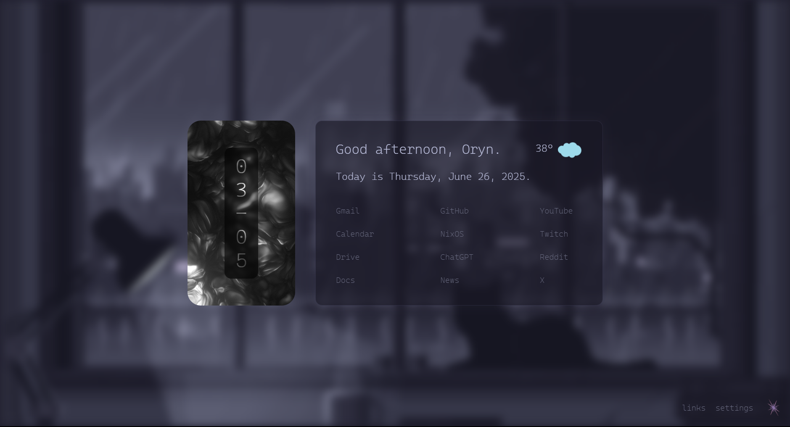
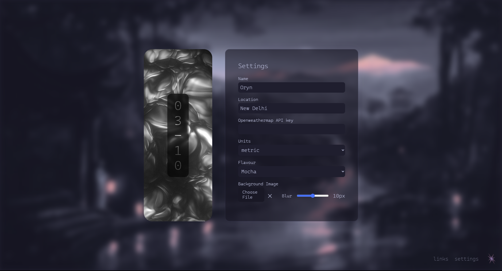
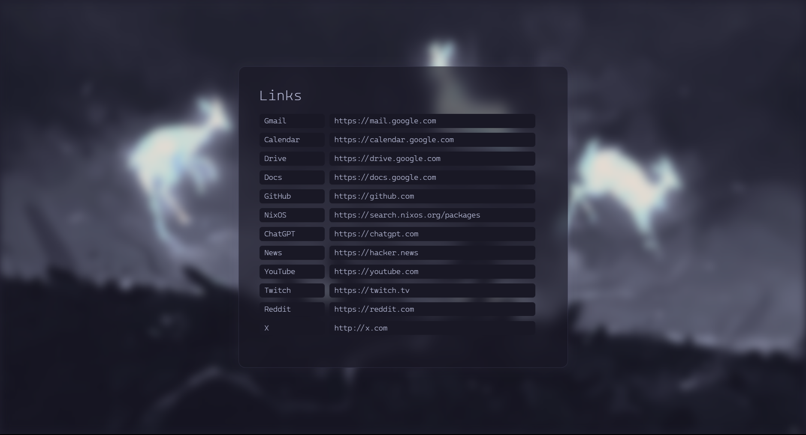

# Startlight

<div align="center">
  
</div>

A new tab page. A clock, the weather, a few links, and a search bar that stays out of the way
until you reach for it.

Svelte, themed with Catppuccin. Built on [refact0r](https://github.com/refact0r)'s work.

Archived at v1.4, July 2025. It still works. It is not being developed.

---

## Install

Install [Cascadia Code](https://github.com/microsoft/cascadia-code) first. The page is set in it
and spacing depends on it.

**Firefox** — download the `.xpi` from [releases](https://github.com/OrynVail/Startlight/releases),
open `about:addons`, then the gear icon and "Install Add-on From File".

**Chrome, Brave** — clone the repository, open `chrome://extensions`, enable Developer Mode,
choose "Load unpacked" and select `public/`.

This is a Manifest V2 extension. Chromium browsers are withdrawing V2 support, so the unpacked
route has an expiry date that is not mine to set. Firefox is the one that keeps working.

---

## Settings

Hover the bottom right corner.

| Setting | What it does |
|---|---|
| Name | What the page calls you |
| Weather | An OpenWeatherMap API key and a location |
| Background | Your own image |
| Flavour | Latte, Frappé, Macchiato, Mocha |
| Quick links | The row of shortcuts |

The weather request is the only thing that leaves the browser. Everything else is stored
locally.

---

## Search

The bar is hidden until hovered. Type to search. Prefix to send it elsewhere.

| Prefix | Engine |
|---|---|
| `!g` | Google |
| `!ddg` | DuckDuckGo |
| `!brave` | Brave Search |

---

## Screenshots

<details>
<summary>View</summary>
<br>

<div align="center">




</div>

</details>

---

## Development

```bash
npm install
npm run dev
npm run build
```

The built extension is `public/`. That is the folder a browser loads, not the repository root.

---

## License

MIT. See [LICENSE](LICENSE).
